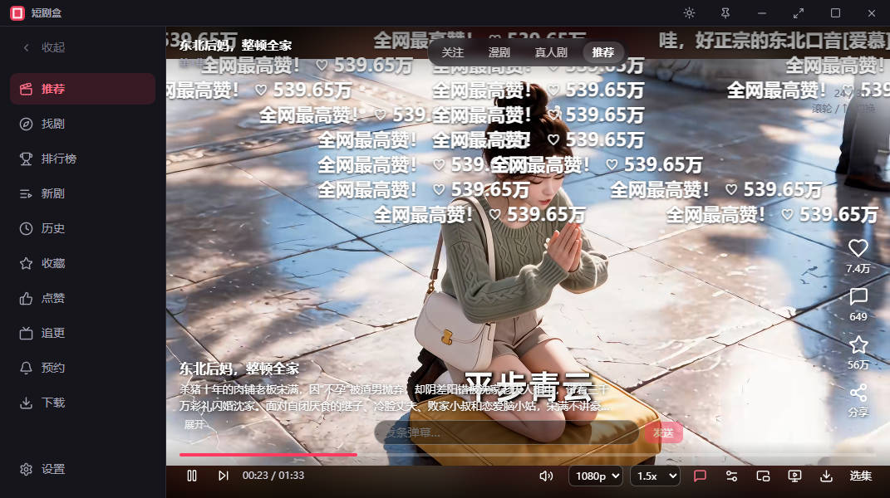

<h1 align="center">&nbsp;短剧盒 · ShortDramaBox</h1>

### 专注短剧的桌面播放器

**小体积 · 免安装 · 零广告 · 跨平台 · 满配体验 · 为刷剧而生**

 

---

## ⚡ 产品亮点

| 亮点 | 说明 |
| :---: | :--- |
| ⚡ **极速稳定** | 秒开即播，即点即看；硬件解码加持，资源占用低，长时间刷剧依旧流畅 |
| 🪶 **小巧精悍** | 安装包仅约 6MB，体积做到极致，核心功能毫不缩水 |
| 📦 **免安装** | 绿色单文件，下载解压即可运行；删除即卸载，不留任何残留 |
| 🚫 **零广告** | 无开屏广告、无贴片、无弹窗，追剧过程不被打断 |
| 🌐 **跨平台** | Windows / macOS / Linux 全平台覆盖，一套代码，一致体验 |

## 🎬 功能特性

### 📺 沉浸刷剧

- **高清播放** — 1080P 多档画质，即点即播，自动记忆播放进度，下次打开无缝续播
- **弹幕互动** — 内置弹幕引擎，支持一键开关与弹幕发送，一个人刷剧也有陪伴感
- **倍速播放** — 多档倍速自由切换，快速补剧、慢速细品两相宜
- **自动连播** — 看完当前集自动播放下一集，刷剧不间断
- **小窗模式** — 置顶小窗播放，工作娱乐一眼兼顾
- **隐私模式** — 无痕观看，不写入本地记录，个人隐私滴水不漏
- **摸鱼模式** — 一键切换低调形态，配合全局快捷键随时唤起或隐藏，安心摸鱼不打扰

### 🔍 发现好剧

- **全网搜索** — 聚合搜索能力，热门短剧一网打尽
- **排行榜** — 热播榜、新剧榜实时更新，第一时间掌握全网热度风向
- **分类频道** — 推荐、漫剧、真人剧等多频道浏览，快速定位下一部好剧

### ⭐ 追剧管理

- **本地记录** — 历史、收藏、点赞、追更、预约，数据仅存储于本地，隐私无忧
- **追更提醒** — 喜欢的新剧一键追更，更新动态及时掌握
- **开播预约** — 提前预约期待新剧，开播不再错过

### ⬇️ 离线下载

- **MP4 下载** — 剧集一键下载为 MP4 文件，离线也能随时刷剧
- **批量缓存** — 整部剧一次搞定，下载任务统一管理

### 🧩 贴心体验

- **任务托盘** — 关闭窗口自动收缩至系统托盘，播放不中断，随时一键唤回
- **设置记忆** — 画质、倍速、弹幕等使用偏好自动记忆，下次打开即恢复
- **主题外观** — 深色 / 浅色主题切换，跟随你的使用习惯

## 🆚 为什么选择短剧盒

| 维度 | 网页版 | 传统视频 App | 短剧盒 |
| :--- | :---: | :---: | :---: |
| 广告干扰 | 较多 | 较多 | **零广告** |
| 安装方式 | 依赖浏览器 | 体积庞大 | **免安装 · 仅 6MB** |
| 弹幕体验 | 一般 | 依赖平台 | **内置增强** |
| 视频下载 | 受限 | 受限 | **MP4 本地下载** |
| 隐私数据 | 云端 | 云端 | **纯本地存储** |
| 摸鱼 / 小窗 | 不支持 | 不支持 | **专属模式** |

## 📥 下载与运行

所有版本均发布于仓库 **Releases** 页面：

| 平台 | 系统要求 | 下载地址 |
| :--- | :--- | :--- |
| 🪟 Windows | Windows 10 / 11（64 位） | [GitHub Releases](../../releases/latest) |
| 🍎 macOS | Intel 芯片 / Apple Silicon | [GitHub Releases](../../releases/latest) |
| 🐧 Linux | 主流桌面发行版 | [GitHub Releases](../../releases/latest) |

> 💡 **国内用户**建议访问 Gitee 仓库的 Releases 页面下载，速度更快。
>
> 📦 下载后解压即可运行，无需安装；删除文件夹即完成卸载。

## ❓ 常见问题

**Q1：使用短剧盒需要安装吗？**
不需要。软件为绿色单文件程序，下载解压后直接运行即可，删除目录即彻底卸载，无任何残留。

**Q2：观看记录、收藏等数据会上传吗？**
不会。历史、收藏、点赞、追更、预约等数据全部保存在本地，软件不收集、不上传任何个人数据。

**Q3：支持哪些操作系统？**
支持 Windows 10/11、macOS（Intel 与 Apple Silicon 芯片）以及 Linux 主流发行版。

**Q4：播放卡顿如何处理？**
软件默认启用硬件解码。如遇兼容性问题，可在设置中切换解码方式，或适当降低播放画质。

**Q5：下载的视频保存在哪里？**
下载的 MP4 文件统一在下载页中管理，可随时查看、播放与清理。

## ⚠️ 免责声明

> 本项目为个人开源学习项目，**仅供学习与技术交流使用，严禁用于任何商业用途**。
>
> 软件本身不存储、不上传、不分发任何视频内容；所有内容均来源于网络公开接口，版权归原作者及原平台所有。
>
> 请于下载后 24 小时内删除本软件，并建议前往正规视频平台观看，支持创作者与正版内容。
>
> 如本项目内容涉及侵权，请联系作者处理，我们将第一时间配合删除。

---

**如果 短剧盒 对你有帮助，欢迎点亮 Star 支持本项目！**

